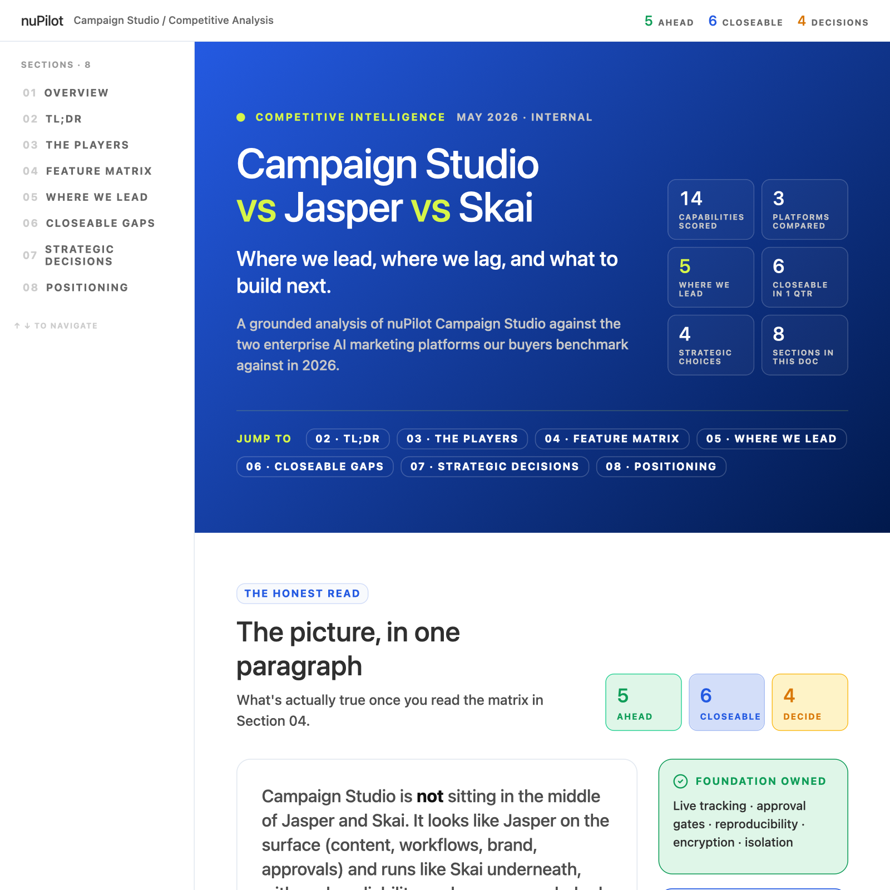

<div align="center">

# Competitor Agent

**Give it one product. Get a sourced, board-ready competitive analysis.**

A multi-agent system that researches a product's top market rivals and renders a polished
*"where we lead, where we lag, what to build next"* briefing — with every competitor claim
grounded in a real source and adversarially fact-checked.




<sub><a href="docs/example-report.html">▶ Open the full sample report</a> · the design every run produces</sub>

</div>

---

## What it does

Hand it a product — a **URL, a repo, a doc, or a one-paragraph description** — and it:

1. **Reads your product** and works out what it actually does (your side, never invented).
2. **Finds the top 2 competitors** in your market by *market leadership*, and checks the picks with you.
3. **Researches them on the open web** — pricing, docs, positioning, momentum, weaknesses.
4. **Fact-checks itself** — every competitor claim is attacked by independent skeptics before it ships.
5. **Renders one self-contained HTML page** — feature matrix, moats, closeable gaps, open questions, positioning thesis, and a sources list.

## Why it's different

Most "AI competitive analysis" produces confident, unsourced fiction. This one is built around two rules:

- 🔒 **No fabricated data.** Every competitor claim traces to a real URL. Anything that can't be verified is marked `unknown` — never guessed. Enforced in code (cite-or-void) *and* by an adversarial verification gate.
- 🪞 **Self-critical, not marketing.** A matrix where you win every row is marketing. The output surfaces real gaps and hard strategic questions — and your own `ahead` only counts where no rival matches you.

That's what makes the result something you can put in front of a board or a sales team and defend line by line.

## Two ways to run it

### A · As a Claude Code skill (`/competitor`)

Zero setup — runs inside Claude Code using the session model and built-in web search.

```
You: do a competitor analysis of https://yourproduct.com
```

It ingests the product, proposes the top 2 rivals for your sign-off, researches and verifies, then writes the HTML. For the exhaustive run it drives a 9-agent fleet via a workflow (see [ARCHITECTURE.md](ARCHITECTURE.md)). Skill entry point: [SKILL.md](SKILL.md).

### B · As a standalone web app

A self-serve product powered by the **Anthropic API** (one key — agents *and* web research).

```bash
cd app && cp .env.example .env        # add ANTHROPIC_API_KEY
cd backend && pip install -r requirements.txt && uvicorn main:app --port 8000
cd ../frontend && npm install && npm run dev      # → http://localhost:5173
```

Enter a product → watch the phases stream live → approve the top 2 → download the report. Full guide: [app/README.md](app/README.md).

## How it works

Phases run in sequence; specialist subagents fan out *inside* each phase and converge. The whole thing is gated on adversarial verification.

```
A · Intake ──▶ [you confirm product] ──▶ B · Discovery ──▶ [you approve top 2]
   ──▶ C · Deep research ──▶ D · Synthesis ──▶ E · Verify (gate) ──▶ F · Render
```

| Phase | Subagents fan out… | …and converge to |
|-------|--------------------|------------------|
| **A · Intake** | readers over your product (docs / source / pricing) | one "our side" profile |
| **B · Discovery** | 4 *blind* market sweeps (alternatives · analysts · funding · community) | top 2 by market leadership |
| **C · Research** | 5 dimensions × 2 rivals, each web-sourced | a sourced profile per rival |
| **D · Synthesis** | matrix builder + narrative writer | a draft `data.json` |
| **E · Verify** | 2–3 skeptics **per claim**, told to *refute* it vs its source | a validated `data.json` |
| **F · Render** | deterministic | the HTML report |

Full design, data contracts, and the verification gate: **[ARCHITECTURE.md](ARCHITECTURE.md)**.

### The agent fleet

Nine single-purpose agents ([`agents/`](agents/)) — each a standalone Claude Code subagent, reused by both the skill workflow and the web app:

`intake-reader` · `product-synthesizer` · `discovery-scout` · `ranker` · `dimension-researcher` · `profile-synthesizer` · `matrix-builder` · `narrative-writer` · `claim-verifier`

## Project layout

```
competitor/
├── SKILL.md                  # the /competitor skill: triggering + workflow
├── PLAN.md  ·  ARCHITECTURE.md  # roadmap and multi-agent design
├── agents/                   # the 9 fleet agents (one file each)
├── scripts/
│   ├── build_page.py         # data.json → styled HTML (the renderer)
│   ├── competitor_workflow.js# the orchestrator (Phases A–E)
│   └── install-agents.sh     # register the agents as live subagents
├── assets/base.css           # extracted design system (inlined into every report)
├── references/               # data schema, research methodology, design tokens, worked example
├── app/                      # standalone web app (FastAPI backend + React/Vite frontend)
└── docs/                     # sample report + hero image
```

## Configuration

The skill uses your Claude Code session. The app reads from `app/.env`:

| Variable | Default | Notes |
|----------|---------|-------|
| `ANTHROPIC_API_KEY` | — | required for the app |
| `COMPETITOR_MODEL` | `claude-opus-4-8` | set `claude-sonnet-4-6` to cut cost ~40% |
| `COMPETITOR_EFFORT` | `high` | `low` · `medium` · `high` · `xhigh` · `max` |
| `COMPETITOR_SKEPTICS` | `2` | verifiers per claim (Phase E) |

A full app run spawns ~20 web-enabled agent calls, so it uses real tokens — scale with the knobs above.

## Status & roadmap

Working today: the renderer + design system, the 9 agents, the orchestrator, and the web app (backend compiles, frontend builds, render path verified). The live end-to-end run is pending an API key. Full roadmap: **[PLAN.md](PLAN.md)**.
